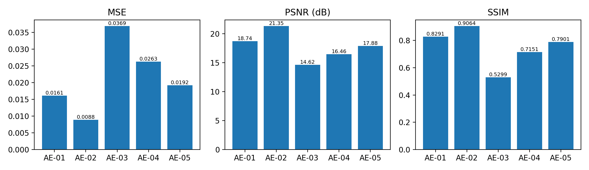
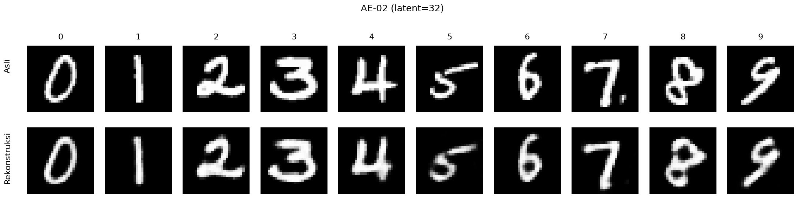

# Convolutional Autoencoder MNIST

Eksperimen **Convolutional Autoencoder (ConvAE)** untuk merekonstruksi citra tulisan tangan dari dataset MNIST. Skrip mengambil subset seimbang sebanyak 5.000 citra, melatih lima variasi konfigurasi, lalu mengevaluasi hasil rekonstruksi pada data uji.

## Isi proyek

- `ae_mnist_dl9.py` — pemuatan data, definisi model, training, evaluasi, dan pembuatan grafik.
- `data/MNIST/` — data MNIST yang diunduh oleh `torchvision` saat pertama kali dijalankan. Jika folder atau berkas data belum tersedia, skrip akan mengunduhnya.
- `hasil_ae/` — keluaran eksperimen yang sudah ada. Menjalankan skrip kembali akan memperbarui berkas dengan nama yang sama.

## Persiapan

Gunakan Python dengan `pip`, lalu pasang dependensi:

```bash
python -m pip install torch torchvision scikit-image pandas matplotlib numpy
```

Untuk GPU NVIDIA, pasang build PyTorch yang sesuai dengan versi CUDA di mesin Anda menggunakan instruksi pada [situs resmi PyTorch](https://pytorch.org/get-started/locally/). Skrip otomatis memakai CUDA jika tersedia; jika tidak, skrip berjalan di CPU.

## Menjalankan

Jalankan perintah dari direktori proyek:

```bash
python ae_mnist_dl9.py
```

Skrip akan membuat folder `hasil_ae` bila belum ada. Data MNIST perlu tersedia secara lokal atau dapat diunduh oleh `torchvision` saat pertama kali dijalankan.

## Metode dan konfigurasi

- Dataset: MNIST, 10 kelas, masing-masing 500 citra.
- Pembagian data: 4.000 train, 500 validasi, dan 500 test; pembagian dilakukan per kelas dengan seed `42`.
- Prapemrosesan: `ToTensor`, sehingga piksel berada pada rentang `[0, 1]`.
- Model: encoder konvolusional dengan bottleneck/latent, diikuti decoder konvolusi transpose dan aktivasi sigmoid.
- Optimizer: Adam; loss training: Mean Squared Error (MSE).
- Model terbaik tiap run disimpan berdasarkan MSE validasi terendah, lalu dievaluasi pada test.

Lima konfigurasi eksperimen didefinisikan dalam daftar `RUNS` di `ae_mnist_dl9.py`:

| Run | Latent | Learning rate | Epoch | Perubahan |
| --- | ---: | ---: | ---: | --- |
| AE-01 | 16 | 0.001 | 30 | Baseline |
| AE-02 | 32 | 0.001 | 30 | Latent 16 → 32 |
| AE-03 | 16 | 0.0001 | 30 | Learning rate 0.001 → 0.0001 |
| AE-04 | 8 | 0.001 | 30 | Latent 16 → 8 |
| AE-05 | 16 | 0.0001 | 200 | Uji konvergensi dengan epoch lebih banyak |

Batch size seluruh run adalah 128. Untuk mengubah parameter atau menambah run, edit daftar `RUNS` di bagian konfigurasi skrip.

## Hasil yang tersedia

Metrik test dari berkas `hasil_ae/hasil_metrik.csv` yang saat ini ada di proyek:

| Run | MSE ↓ | MAE ↓ | PSNR (dB) ↑ | SSIM ↑ |
| --- | ---: | ---: | ---: | ---: |
| AE-01 | 0.01613 | 0.04511 | 18.737 | 0.82907 |
| AE-02 | **0.00885** | **0.03015** | **21.353** | **0.90642** |
| AE-03 | 0.03692 | 0.08942 | 14.622 | 0.52986 |
| AE-04 | 0.02629 | 0.06551 | 16.464 | 0.71510 |
| AE-05 | 0.01919 | 0.05043 | 17.881 | 0.79009 |

Nilai tersebut berasal dari hasil run yang tersimpan; menjalankan ulang eksperimen dapat menghasilkan nilai dan waktu training berbeda, bergantung pada perangkat keras dan lingkungan.

Ringkasan grafik metrik:



Contoh citra asli dan rekonstruksi untuk AE-02:



## Berkas keluaran

Semuanya dibuat di `hasil_ae/`:

- `konfigurasi.csv` — konfigurasi eksperimen, informasi framework, perangkat keras, dan waktu training.
- `hasil_metrik.csv` — metrik evaluasi test tiap run.
- `history_<RUN>.csv` — MSE train dan validasi per epoch.
- `loss_<RUN>.png` — grafik loss train/validasi.
- `recon_<RUN>.png` — contoh citra asli dan rekonstruksi test, satu contoh per kelas.
- `perbandingan_run.png` — ringkasan perbandingan MSE, PSNR, dan SSIM.
- `best_<RUN>.pt` — bobot model dengan loss validasi terbaik.

Metrik yang dihitung: MSE, MAE, PSNR (`MAX=1`), dan SSIM (`data_range=1`).
